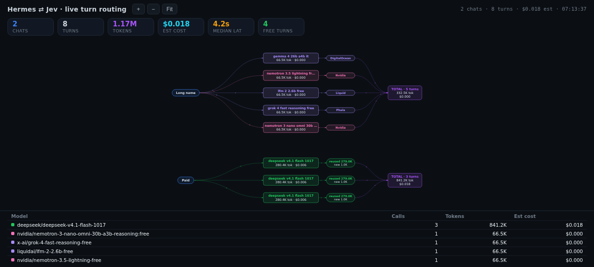

# jev-live-flow

Live, left-to-right visualisation of Hermes chat turns.

For each active chat you see:

- the chat (a short keyword summary of its real title)
- the last few turns as rounded cards: **which model actually served it**, total tokens, and estimated cost
- a **chip** per turn — for free-router turns, the provider that actually served it
  (`DigitalOcean`, `Poolside`, `Phala`, …); for paid turns, the **reused vs new**
  token split (`reused 280.2K / new 284`) taken from the provider's own cache report
- a **running total** per chat (turns, tokens, cost)
- a summary strip (all-chat totals) and a compact per-model cost table



Design rules baked in:

- The stack only advances when a genuinely new turn arrives — a passive chat never moves.
- Only nodes whose position changed animate.
- Free models cost `$0.000`.
- The model shown is what actually ran; it is never guessed from a timestamp match.
- Pan and zoom are never reset by an update. A new chat row triggers one fit so it
  cannot appear off-screen.

## Requirements

| Requirement | Needed? | Why |
|---|---|---|
| Hermes Agent `>=0.21.0` | **required** | the plugin reads `$HERMES_HOME/logs/agent.log` and `$HERMES_HOME/state.db` |
| Python 3.9+ (**stdlib only**) | **required** | no pip packages, no venv changes, `python_dependencies: []` |
| Jev router | **optional** | nothing to configure. If Jev routes your turns, the arm shows the routed model because that is what `agent.log` records; without Jev it shows the requested model |
| Hermes Web UI (`hermes-webui`) | optional | only for the embedded "Live Flow" tab; the standalone page works without it |

D3 is vendored and **inlined into the page at build time** — no CDN, no node build
step, no network request from the browser.

## Install

```bash
hermes plugins install rabecaps/jev-live-flow     # or: hermes plugins install jev-live-flow
hermes plugins enable jev-live-flow
```

Then restart the gateway so the tools register. To keep the UI running across
reboots, install the bundled unit:

```bash
cp systemd/jev-live-flow.service ~/.config/systemd/user/
systemctl --user enable --now jev-live-flow
```

## Use

```
jev_live_flow_start     → start the UI, returns the URL
jev_live_flow_status    → is it running, and where
jev_live_flow_stop      → stop it
jev_live_flow_config    → change host/port/window/arms/timezone
```

Defaults: `127.0.0.1:8780`, 15-minute window, 5 turn cards per chat, 3 chats.

To expose it on the LAN set `host` to `0.0.0.0` and restart. There is **no
authentication** — keep it on loopback unless you understand the exposure.

## What this plugin touches on your system

Disclosed up front, because you should know before installing:

- **Reads** `$HERMES_HOME/logs/agent.log`, `$HERMES_HOME/state.db` (session
  titles only) and, if present, `$HERMES_HOME/logs/jev-decisions.jsonl`. Nothing
  outside `$HERMES_HOME`.
- **Writes** only `$HERMES_HOME/plugin-data/jev-live-flow/config.json`, plus the
  published page described below if you opt in.
- **Runs a local HTTP server** on `127.0.0.1:8780` by default (loopback only,
  no auth, GET-only).
- **No network calls** to third-party services. No telemetry, no analytics, no
  update checker.
- **No credentials** are read, stored, or transmitted. The plugin does not read
  `.env`, `auth.json`, keychains, browser profiles or any vendor CLI token.
- **No shell commands** are spawned and no core Hermes code is patched,
  wrapped or rebound.

### Optional: the embedded Web UI tab

The tab needs the page served from the web UI's `/static/` path — pages under
`/dashboard-plugins/` are served with `CSP: sandbox`, which makes the frame an
opaque origin where `fetch()` is CORS-blocked, so a live-polling page cannot work
there.

Publishing is **opt-in and off by default**. Set `publish_dir` in the config file
to your web UI's static directory and the plugin writes two files there:

```
<static>/jev-live-flow/index.html   the UI, d3 inlined
<static>/jev-live-flow/data.json    the live payload, polled every 3s
```

Understand the trade-off before enabling it: `/static/` is **unauthenticated**,
so that page is reachable without a login on that host (whatever edge auth you
run in front of it still applies), and it writes into another application's
install tree. Without `publish_dir` the plugin never writes outside its own
`plugin-data` directory and the tab is simply not available.

## Configuration

`$HERMES_HOME/plugin-data/jev-live-flow/config.json` (created on first run):

```json
{
  "host": "127.0.0.1",
  "port": 8780,
  "window_minutes": 15,
  "max_arms": 5,
  "max_chats": 3,
  "poll_seconds": 3,
  "timezone": "Australia/Perth",
  "publish_dir": "",
  "rates": {
    "deepseek/deepseek-v4.1-flash-1017": {"in": 0.022, "out": 0.09}
  },
  "default_rate": {"in": 0.2, "out": 0.8}
}
```

`rates` are **$ per 1M tokens** and are estimates — set them to your provider's
current prices. Any model whose name contains `free` is costed at `$0`.
`JEV_LIVE_FLOW_PUBLISH_DIR` overrides `publish_dir` if set.

## Data sources

| Source | Used for |
|---|---|
| `$HERMES_HOME/logs/agent.log` | per-turn model, tokens, cache, upstream, request id |
| `$HERMES_HOME/state.db` → `sessions.title` | chat keyword labels |
| `$HERMES_HOME/logs/jev-decisions.jsonl` | reserved (routing reason) |

## Known limitations

- **Cost is an estimate** derived from the token counts in `agent.log` and the
  rate table. It is not billed cost. For exact numbers use the provider's API.
- **No tools-vs-memory-vs-context split.** The provider reports one aggregate
  prompt-token count plus a cache figure. Only *cached (reused)* vs *fresh* is
  real; a three-way split would be fabricated.
- **No served-model field on some transports.** If the response object does not
  expose the served model, the arm falls back to the requested model.
- **Turns older than the window drop out of the payload** but stay on screen
  once drawn; the stack only advances on a new turn.
- Single-user, no auth, layout state lives in the browser.

## Uninstall

```bash
hermes plugins disable jev-live-flow
hermes plugins remove jev-live-flow
systemctl --user disable --now jev-live-flow   # if you installed the unit
rm -rf $HERMES_HOME/plugin-data/jev-live-flow  # config + any published page
```

If you enabled `publish_dir`, also delete `<static>/jev-live-flow/`.

## License

Plugin code: MIT — see `LICENSE`.
Vendored D3 v7: MIT — see `static/vendor/LICENSE-d3.txt`.
